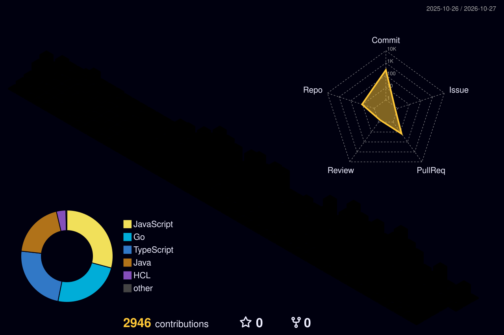

  <h1 align="center">Oi, eu sou o Vinícius 👋</h1>
  
Desenvolvedor de Software | FIAP | São Paulo, Brasil

  
  
  

---

### Sobre mim

Eu sou um programador apaixonado por **código e música**, com 19 anos e atualmente cursando Engenharia de Software na FIAP. Meu objetivo é me tornar um desenvolvedor **habilidoso e competente**, focado em criar soluções eficientes e com design moderno. Quando não estou programando, estou tocando minha guitarra ou explorando novos mundos em videogames.

---

### Tecnologias e Ferramentas

Tenho experiência com as seguintes tecnologias e estou sempre buscando aprender mais:

  

---

 
